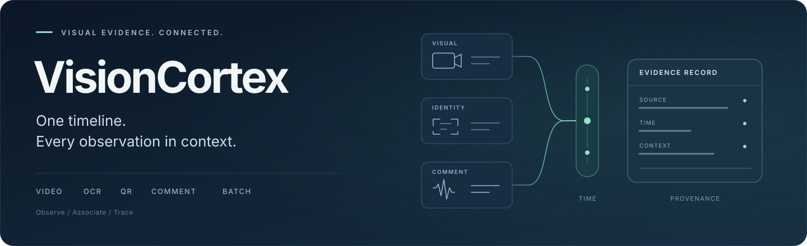
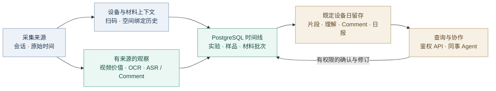

<p align="center">
  
</p>

<p align="center">
  <strong>把实验现场，连接成可追溯的记录。</strong><br>
  视频理解 · 屏幕 OCR · 二维码 · 口述 Comment · 材料批次
</p>

<p align="center">
  <a href="#快速开始">快速开始</a> &nbsp; / &nbsp;
  <a href="#能力地图">能力地图</a> &nbsp; / &nbsp;
  <a href="#一条完整链路">完整链路</a> &nbsp; / &nbsp;
  <a href="#留存即接口">留存格式</a> &nbsp; / &nbsp;
  <a href="#按角色阅读">文档导航</a>
</p>

---

**VisionCortex 将视频分析与 FieldRecognition 合为同一个工程。** 多路采集、主动扫码、
屏幕读数和口述围绕同一物理时间线关联，在 PostgreSQL 中保留操作上下文、实验与材料批次历史，
并按既定 NAS 格式留存片段、理解、Comment 和日报。结果连同源媒体、时刻、版本与修订关系一起保存，供回看、查询和业务系统使用。

现有 VC／FR 模型与权重可通过显式配置复用，无须另建项目；
模型文件、现场身份、原始数据、存储地址与凭据均由私有部署提供。
本仓库提供 Web、CLI 和 API，Agent 界面由集成方对接现有鉴权接口。

> **当前边界：** 统一模块、接口与选定专项测试已实现；实际模型调用、现场识别质量、
> 跨模态完整闭环和正式 NAS 发布分别验收。保存了原片或生成了报告，都不等于识别已经通过。
> 详见[实现与验收状态](docs/reference/lab-vision-status.zh-CN.md)。

## 快速开始

**先启动本地工作台。** 准备 Git 与 Python 3.11／3.12，在完整源码目录中执行：

```bash
git clone https://github.com/RealityLoopAI/VisionCortex.git
cd VisionCortex
python3.11 -m venv .venv
source .venv/bin/activate
python -m pip install -e .
./start-visioncortex.sh --check-only
./start-visioncortex.sh
```

打开 **[localhost:8000](http://127.0.0.1:8000/#/home)**。
默认[本地配置](configs/development-local.yaml)关闭 NAS 自动采集与模型调用，附带空采集索引；
首次启动无需 GPU、权重或 API 密钥。真实分析需按所选部署配置 FFmpeg、模型及数据来源。

<details>
<summary><strong>Windows PowerShell</strong></summary>

```powershell
git clone https://github.com/RealityLoopAI/VisionCortex.git
cd VisionCortex
py -3.11 -m venv .venv
.\.venv\Scripts\python.exe -m pip install -e .
.\Start-VisionCortex.bat -CheckOnly
.\Start-VisionCortex.bat
```

也可双击 `Start-VisionCortex.bat`；macOS 可使用 `Start-VisionCortex.command`。
端口冲突时传入 `--port 8010`，Windows 使用 `-Port 8010`。
Python 3.12 对应替换创建环境命令中的版本号。

</details>

**接入统一实验模块。** 使用同一环境安装可选依赖，再查看命令和核验冻结资源：

```bash
python -m pip install -e ".[lab]"
visioncortex lab --help
visioncortex lab verify-components
visioncortex lab verify-rules
```

也支持 `python -m visioncortex.lab`。上述核验不启用采集、模型或数据库服务。
实际业务接入需专用 PostgreSQL 和显式部署配置，见[集成指南](docs/reference/agent-integration.zh-CN.md)。
更多安装、预检与故障排查见[本地开发指南](docs/guides/local-development.zh-CN.md)；
已部署服务的使用者直接阅读 [10 分钟操作指南](docs/VisionCortex-普通用户10分钟操作指南.md)。

## 能力地图

| 能力 | 工程提供 | 结果如何约束 |
| :--- | :--- | :--- |
| **视频与价值切分** | 多视角对齐、检测与跟踪、候选边界、关键素材及多模态步骤理解 | 实验、非实验价值与证据未知分开；等待不自动判无价值，未分析区间明确保留。 |
| **连续屏幕与指针读数** | 时序缓冲、稳定结构配准、局部像素融合、OCR 适配与已标定指针换算 | 字段与设备隔离；缺笔画、小数点、单位或标定时保留候选，不补造数值。 |
| **二维码与操作上下文** | 主动扫码立即建立当时设备上下文；解析历史标签、容器与材料来源 | 被动入镜只记录观察；设备切换不等于实验结束，主操作设备不代替所有面板归属。 |
| **口述 Comment** | 原音、转写、时间范围与结构化阶段解释；记录已完成步骤和后续计划 | 完成当前步骤与完成整个实验分开；说话人、时钟和跨模态冲突保留来源。 |
| **材料与批次账本** | 区分来源批次与制备批次；Decimal 数量、单位、修订和全局只读汇总 | 材料关联不扣库存；明确业务才入账，未知余额不当作零，分装不重复计消耗。 |
| **任务、查询与留存** | 持久队列、租约、检查点、晚到证据、鉴权 API、设备日报与版本化发布 | 原始证据不覆盖；阶段结果与正式发布分开，重试和夜间成本依据实际回执。 |

[算法与业务逻辑](docs/reference/lab-vision-algorithms.zh-CN.md)详述各路径的门控与限制。
价值候选、ASR 转写候选与已持久化的结构化 Comment 解释已接入统一消费；
真实跨模态关联与识别质量仍需现场验证，不以单次模型返回或合成测试替代。

## 一条完整链路



口述是有语义的 Comment：与原音及转写范围一起参与溯源。
“此处配制完成，接下来去下一设备”保留同一样品／批次，只完成当前阶段并记录计划；
到下一设备主动扫码后再切换当前操作上下文。只有明确的整体完成声明才进入实验完成流程。
ASR 保存后自动进入 Comment 候选；上游已有的来源固定结构化解释自动进入阶段转换。
缺少可靠语义或目标时保留待解释，不靠关键词宣布实验完成；不要求提供说话人身份。

晚到的录音、读数和绑定以修订追加；时间邻近不自动证明属于同一实验，
采集佩戴者也不自动等于说话人。单个模型窗口、文件切点或设备切换不重定义实验边界。

<details>
<summary><strong>代码导航与现有模型复用</strong></summary>

| 位置 | 职责 |
| :--- | :--- |
| [`src/visioncortex`](src/visioncortex) | 视频分析、任务、查询与 Web／CLI 入口。 |
| [`src/field_recognition`](src/field_recognition) | FieldRecognition 实现。 |
| [`src/visioncortex/lab`](src/visioncortex/lab) | 统一时间线、主动扫码、时序读数、Comment 与材料批次。 |
| [`components/lab`](components/lab) · [`contracts/lab`](contracts/lab) · [`migrations/lab`](migrations/lab) | 兼容组件、版本规则与 PostgreSQL 迁移。 |
| [`tools/inference`](tools/inference) | 本地模型服务源码；配置与运行见[服务指南](deployment/inference/lab-services.md)。 |

VC／FR 现有权重以私有路径、版本和文件指纹显式绑定。
源码安装不下载或启动模型，也不会切换已有服务与生产配置；复用权重仍需核验适用数据与质量。

</details>

## 留存即接口

一个设备日保留采集端原名与四个结果目录。视频、语音、照片读数共用来源关系与时间线：

```text
<日期>_<相机>/
├── MetaData/                         采集端原始目录；MetaVideo/ 存在时同样原位保留
├── ProcessedClips/                   所选片段、覆盖记录与原片时间映射
├── MultimodalUnderstanding/          对应片段的步骤理解与来源引用
├── LaboratoryDailyReport/            设备日报与关联记录
└── Comment/
    ├── Audio/                       原音／转写的兼容关联与时间索引
    └── OCR/
        ├── VoicePhotoReadings/
        └── VideoReadings/
```

OCR 保持固定六字段：`wearer_id`、`device_model`、`device_no`、`qr_hash`、`photo_time`、`values`。
`wearer_id` 仅保留旧格式兼容，可为空；本工程不接收或等待人员身份，按采集来源和时间完成识别、处理与设备／材料关联。
多源引用、源时钟、模型／规则版本与历史修订通过证据关系关联，不用改写这六字段承载。
原始目录、原音和历史格式保留兼容，正式公开留存采用既定 JSON 与媒体结构。
目录细节见[统一留存](docs/reference/unified-retention.zh-CN.md)、
[设备日契约](docs/DEVICE-DAY-ARCHIVE-CONTRACT.zh-CN.md)与 [Schema](docs/contracts/device-day-v1.schema.json)。

既有离线多视角入口继续保留 `Experiment-Clips`、`JSON-Config-Files`、`Key-Materials`、
`Lab-Daily-Reports` 和 `Professional-PDFs`，见[产出参考](docs/FEATURES-AND-OPERATIONS.zh-CN.md#产出)。

## 按角色阅读

| 你要做什么 | 从这里开始 |
| :--- | :--- |
| **使用已部署工作台** | [10 分钟操作](docs/VisionCortex-普通用户10分钟操作指南.md) · [结果阅读](docs/guides/results.zh-CN.md) · [功能与操作](docs/FEATURES-AND-OPERATIONS.zh-CN.md) |
| **部署与配置服务** | [端到端交付](docs/VisionCortex-端到端视频分析交付手册.md) · [后台服务](deployment/rtx3090ti-ubuntu/README.md#服务与存储) · [RTX 4060](deployment/rtx4060/README.md) · [本地模型服务](deployment/inference/lab-services.md) |
| **对接业务与 Agent** | [鉴权接口与完整闭环](docs/reference/agent-integration.zh-CN.md) · [机器 API／GPU worker](deployment/inference/README.md) · [统一任务与检索契约](docs/UNIFIED-TASK-RETRIEVAL-CONTRACT.md) |
| **维护采集与恢复** | [设备日运维](docs/DEVICE-DAY-OPERATIONS-OVERVIEW.zh-CN.md) · [NAS 原位预处理](docs/NAS-INPLACE-PREPROCESSING.zh-CN.md) · [LabVideo](docs/LAB-VIDEO-MONITORING.zh-CN.md) · [运行层](docs/UNIFIED-RUNTIME-WORK.md) · [阶段恢复](docs/STAGE-RECOVERY.md) |
| **开发、模型与标注** | [本地开发](docs/guides/local-development.zh-CN.md) · [模块职责](docs/reference/architecture.zh-CN.md) · [标注与训练](docs/PROJECT-ANNOTATION-TRAINING.zh-CN.md) · [框真值契约](docs/YOLO-Box-Ground-Truth-and-Annotation-Contract.zh-CN.md) |
| **核对交付与验收** | [实现状态](docs/reference/lab-vision-status.zh-CN.md) · [验收单模板](docs/VisionCortex-交付验收单模板.md) · [全部文档](docs/README.md) |

CLI 分析使用[输入清单示例](examples/manifest.example.yaml)与[输入说明](docs/FEATURES-AND-OPERATIONS.zh-CN.md#输入清单)。
模型、媒体、运行证据与密钥留在受控外部存储中，现场配置不进入 Git。

## 如何判断结果可信

| 层次 | 能说明什么 |
| :--- | :--- |
| **软件实现与专项测试** | 指定规则、接口、事务与异常路径按相应测试工作。 |
| **实际模型执行** | 固定输入和模型确实被调用，保留执行回执；不单独证明内容正确。 |
| **真实验收与交付** | 适用现场的质量、覆盖、时钟、归属、运行成本及发布链路逐项通过。 |

证据不足时保留 `PARTIAL_EVIDENCE` 或 `NOT_PROVEN`；`PROVEN` 只覆盖对应回执明确支持的范围。
夜间完成能力依据完整批次的阶段墙钟、质量与次班积压判断，缺失耗时保持未知。
长期记忆四路研究的最终核验与归档仍未闭合，不能作为已交付容量承诺。

<details>
<summary><strong>可选：查看合成结构示例</strong></summary>

```bash
visioncortex dry-run --config configs/development-local.yaml --output outputs/dry-run
```

此命令只用合成数据检查目录与契约，不证明真实模型或实验识别效果。
开发变更按[本地指南](docs/guides/local-development.zh-CN.md)运行相关检查；交付时按验收单记录固定源码、配置、实际回执与缺口。

</details>
