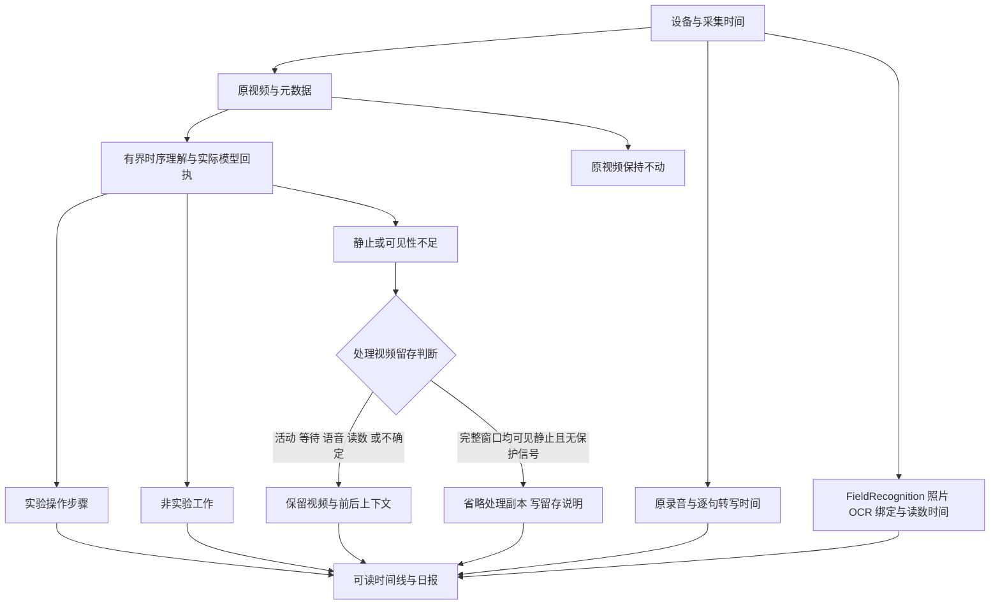

# 全天记录：准入、请求覆盖与跨项目事件

[文档导航](../README.md) · [自动采集与服务](automation.zh-CN.md) · [归档契约](../DEVICE-DAY-ARCHIVE-CONTRACT.zh-CN.md)

本文说明当前源码中的执行边界和配置。代码实现、确定性测试、实际消费者启动、部署身份、真实运行和人员级业务验收分别记录；本文不构成已上线或质量通过的证明。现场模型、端点、设备角色和存储根继续由私有配置确定。

## 一次准入与有界调度

`DeviceDayQueue` 持久保存 `processing_cohort`、`admission_reason`、`admitted_at`、`admission_signature`、`first_ready_at`、`last_dispatch_at` 和 `blocked_reason`。事件发生时间仍来自录像记录，不能改成准入时间。已通过先决条件核验、且来源签名仍一致的 `live` / `current_recovery` 任务可在近期时间窗之外继续被选择；来源变化不会继承旧资格。旧数据库迁移不自动给历史记录补准入，也不清空失败次数。

`device_day.admission_restore` 可指向经过审核的本地恢复清单。配置仅包含绝对本地 `path` 和文件实际 `sha256`；清单最大 1 MiB，内容校验不符或路径不属于本地存储时拒绝加载。清单格式如下，示例中的标识必须替换成当前核验结果：

```json
{
  "schema_version": "visioncortex-admission-restore/1",
  "historical_paid_authorized": false,
  "entries": [
    {
      "stage": "understanding",
      "recording_id": "REPLACE_WITH_VERIFIED_RECORDING_ID",
      "source_signature": "REPLACE_WITH_VERIFIED_SOURCE_SIGNATURE",
      "processing_cohort": "current_recovery",
      "admission_reason": "reviewed_current_candidate_recovery"
    }
  ]
}
```

每项绑定一个阶段、一个录像和一个来源签名。此清单只恢复列出的当前任务资格；`backfill.enabled` 及历史付费授权仍独立。清单不绕过源隔离、先决条件、请求计划暂停或外部提交结果未知的暂停。

理解队列可使用 `device_day.scheduling`：`enabled` 默认 `false`，`max_ready_wait_seconds` 默认 `900`，`capacity_horizon_seconds` 默认 `3600`。默认 `resource_shares` 为 `experiment_candidate: 4`、`support_activity: 2`、`unresolved: 2`、`historical_backfill: 1`。启用后按已消耗工作秒数、机位和等待老化排序；权重和时间参数均须为有限正数。它不保证在过载时满足延迟目标。队列快照分别给出等待、阻塞原因、估计服务时间以及 `UNKNOWN_COST` / `OVERLOADED` / `WITHIN_HORIZON`；估计缺失不会写成零。

## 新视觉请求入口与配置

`understanding_coverage_since_us` 是新录像进入此执行器的时间切点；未设置时保留历史入口。`experiment_steps_since_us` 独立控制结构化步骤模式。切点不是历史批量付费授权。公开默认配置继续关闭自动处理和模型调用。

| `device_day` 设置 | 执行器默认值 | 作用 |
| --- | --- | --- |
| `understanding_active_fps` | `4` | 实验候选的基础时间采样；源帧不足时不能制造帧 |
| `understanding_event_fps` | `10` | 已选动作帧附近加密采样 |
| `understanding_event_radius_ms` | `1000` | 动作帧前后加密半径 |
| `understanding_frames_per_request` | `48` | 单请求帧数上限；溢出拆窗 |
| `understanding_window_seconds` | `30` | 时间窗上限；不表示每个请求实际覆盖 30 秒 |
| `understanding_overlap_frames` | `2` | 为相邻窗口保留上下文重叠容量 |
| `inactive_sample_seconds` | `1` | 未确认价值区间的原有间隔抽样起点 |
| `understanding_inactive_window_limit` | `12` | 无保护信号的长 inactive 异常计划检查阈值 |
| `understanding_requests_per_turn` | `1` | 每轮新增、已保存请求的工作量；`0` 表示不按请求数让出本轮 |

基础采样、事件邻域、动作必选帧和边界帧各自保留选帧理由；不会只取准备列表的前 48 帧，也不会把整段实验均匀稀释到 48 帧。选帧时间来自现有 `SourceFrameTrace` 的 native PTS 元数据。新窗口先持久保存 `SelectedWindows.json`；仅对尚无可验证图片的窗口进行有界 seek，以 native PTS 选择解码输出，并核对解码日志的 time base、PTS 序列及输出尺寸。新图片保留解码像素摘要和 `exact_decoder_pts_before_scale` 依据；历史回执的原时间依据保持不变。缺少或歧义的 native 身份会失败关闭。PTS/像素连接成立不代表模型关注了每帧，也不代表动作语义通过。

完成每个请求后先持久保存输入、结果和覆盖回执。达到本轮工作量且仍有下一窗时，阶段返回 `scheduled_checkpoint`，队列重新调度；缓存命中不消耗新增请求份额。恢复在打开解码器前验证保存的选帧、图片哈希、时间映射及实际请求输入，再查询模型结果。全部命中时不解码、编码或写图片；尚未完成窗口仍计入有界解码工作（含 seek 前滚）。同一来源的新解码/缩放 recipe 可能产生不同图片和请求键，不能把旧结果改贴成新 recipe 的结果。此前付费响应按其原精确输入复用。该状态不是模型失败，也不是整段已完成。

这些开关不替换 `mllm` 的模型、厂商、端点、并发与提交尝试设置，也不改变相机角色、源目录或来源哈希。改变视觉采样或输出契约必须形成新执行身份，不能给旧结果重贴身份。已验证的历史完成回执应按其原始执行绑定读取。

## 影子价值判断、异常计划与人工处置

活动语义和可观察性分别记录。实验候选、已选动作、实验等待、前后候选之间的等待、明确重叠的语音/OCR/绑定/事件，以及遮挡、模糊、源缺口和时间不确定性构成保护信号。时间点事件遵循 `[start, end)`：落在区间开始时包含，落在区间结束时进入下一段。无音频不等于无交流，inactive 不等于没有工作。

稳定 episode 当前仅以已有场景素材的精确哈希作影子记录；稀疏画面不能证明全段稳定。episode 保留来源区间列表、检查方式、覆盖和退出原因；只有明确机位、采集 session、无时间缺口且场景签名一致时才可合并影子记录。`confirmed_stable` 和 `paid_filter_applied` 保持 `false`，质量为 `NOT_PROVEN`。不存在已验证的全段自动稳定过滤。

无保护信号的长 inactive 计划超过阈值时，暂停该来源区间的付费提交。所有区间均暂停时不初始化请求分析器；混合录像先处理可执行区间并优先保留实验窗口，保存可校验的 partial 回执，然后仍返回 `waiting_for_plan_review`。原任务、来源、时间范围和计划保留；不会把整条录像发布成 completed，也不会通过失败重试循环持续付费。等待、遮挡及动作保护区间继续保守处理，不能按一个 inactive 标签吞掉。

人工处置先复核连续原片及所有拟过滤类别，明确所需证据或经审核的有界执行策略，再处理对应队列暂停。`DeviceDayQueue.release_hold(recording_id, reason=..., evidence=..., expected_revision=..., source_signature=...)` 对异常计划要求匹配当前 revision 和来源签名，并记录审查依据。先提供执行器能够消费的决定，再解除该条暂停；不能仅调用 release_hold 后让同一计划反复暂停。队列快照显示 `oldest_plan_review_wait_seconds` 和 `overdue_plan_review_count`，900 秒审查目标只用于暴露积压，不是自动删除、撤销资格或付费放行。当前没有面向普通用户的一键稳定过滤或人工标注放行界面；不可用批量归零重试代替审核。

`device_day.understanding_plan_reviews` 可引用一个经审核的本地不可变 JSON（绝对 `path` 和文件 `sha256`，最大 1 MiB）。schema 为 `visioncortex-plan-reviews/1`，`entries` 每项包含 `recording_id`、`source_signature`、`vision_key`、`segment_id`、`plan_identity`、`action: execute_bounded`、`paid_authorized: true`、`maximum_requests`、`reviewed_by` 和 `evidence`。`plan_identity` 是当前计划行的 `segment_id/source_ref/start_ms/end_ms/estimated_requests_upper_bound` 加 `policy` 的规范 digest。额度必须涵盖该完整计划且不超过 10000 窗；执行还逐窗检查该额度，超出时保存 partial 并停止新提交，不稀释或裁掉尾段。

这项决定只解决精确来源与计划的异常暂停，不替代 cohort/history 付费授权、先决条件、来源校验或 submitted_unknown 账本检查。未提供实际授权时只保留待审计划；不得自动生成 `paid_authorized: true` 的现场决定。真实晚到保护信号可重新规划相应区间，稳定过滤继续保持影子。

## Coverage Manifest 与费用回执

新入口在设备日 `MultimodalUnderstanding/RequestPlans/<recording_id>/<execution_key>/SamplingCoverage.json` 保存计划和执行覆盖。内容包括：原始来源区间、采集可用性、本地 CV 扫描覆盖、实际选帧 PTS、逐帧原因、与用量账本相同的请求键、提交/返回状态、结果身份、最大帧间隙、可见性缺口和人工语义召回状态。实际已验证请求覆盖与计划覆盖分开；计划并集不能证明模型已经理解。

视频请求为采样图片；video-only 阶段不使用 STT 或日报模板作为视觉输入身份。晚到事件可更新保护信号、融合和人员视图；已经完成且视觉输入未变的回执不因纯上下文更新自动失效。具体关联和完整性仍须查看相应版本与来源。

本地 `state/MultimodalUsage.sqlite3` 保存调用、唯一请求领取和临时已接收回执。默认临时恢复回执每项最多 `2 MiB`、总共 `64 MiB`，通过 `mllm.local_receipt_max_bytes` / `local_receipt_total_bytes` 配置；这是回执恢复容量，不是复制原视频的额度。容量不足时停止新提交并保留工作。NAS 失效时正式发布失败关闭，已经收到的响应先保存在声明的本地恢复区，存储恢复后可重放发布。

超时、进程中断或结果不明保留 `submitted_unknown` / 未结束 reservation；过期租约、队列重领或本地锁不能证明供应商未执行。需要核验已保存供应商 request ID、实际响应及相同范围账单，再通过受控流程修复原回执；直接解除队列暂停也不会解除账本的未知提交保护。失败但有用量的尝试仍进入账本，未知 Token 或费用保持未知。

离线读取现有账本不发起供应商请求：

```bash
python -m visioncortex.multimodal_usage --config /path/to/private-profile.yaml --date YYYY-MM-DD
```

保存的账单及范围文件可分别通过 `--vendor-usage` 和 `--scope` 输入。对账要求一致的账户、厂商、模型、时间窗、请求 ID、缓存/非缓存/输出用量、货币和倍率；同 Token 不同金额应为 `MISMATCH`。缺价格为 `UNKNOWN_PRICE`，缺供应商为 `PENDING_VENDOR`，范围或用量不齐为 `PARTIAL`。本地账本不自动导入所有历史调用，局部匹配不能宣称全日对账。既有可选每日阈值不应为节费而新增启用来静默漏任务。

## FieldRecognition 与人员视图

VisionCortex 继续负责视频与处理，FieldRecognition 继续生产照片/OCR/设备及人员事件。消费开关是 `device_day.field_recognition.enabled`，默认关闭；启用还须明确 `endpoint` 服务 origin 和互不重复的 `camera_ids`，可配置 `tenant`、`pages_per_tick`（默认 `2`）、`page_size`（默认 `100`）和 `timeout_seconds`（默认 `5`，最大 `30`）。不要把凭据写进 URL。

`PublicationReplay.tick` 在实际启用配置下调用 `/api/events/feed` 消费者；既有 `/api/events` 继续用于浏览器 SSE 通知。本地 `device-day/field-events.sqlite3` 将事件、去重和游标一致提交。来源实例变化、重复投递、确认丢失、更正和撤回保留可恢复身份。设备日索引经过现有回执和产物门禁后，可投影视频/语音事件进入同一 inbox。消费者未启用、未收到和摄像机未配置各有状态，不能当作已取得现场事件。

人员输出位于本地 `device-day/PersonDay/`，保留版本、来源引用、未知和冲突。佩戴者与操作人分别呈现；有效绑定采用 `[valid_from, valid_to)`，唯一有效关系仍标为 inferred，不把固定相机永久等同一个人。缺时钟或换人边界不确定时保留 unknown/conflict；动作不会仅按时间接近合并或按 SOP 补齐。

这些输出是确定性事件视图，人员归属正确率和全天完整性仍为 `NOT_PROVEN` / `PARTIAL_EVIDENCE`。人员事件保留完整原始索引/窗口输入引用；视图中的采集覆盖只携带状态、时钟摘要和原诊断引用，模型窗口的图片身份与时间只出现一次。完整 CV 诊断、时钟 points 和选帧验证账本仍在原索引/Input.json，不复制到每个事件和每个修订中。投影 recipe 版本参与事件修订身份，不能复用旧修订键改变事件内容。

达到既定本地容量时，显式调用 `archive_person_history(config, runtime_root, destination)` 提供获授权的历史归档根和存储检查。它持有人员发布锁，仅复制已被替代的 `Revision*.json`，验证内容、源稳定性和完整 SHA256，持久保存 `HistoryArchives.json` 的原路径映射后才回收本地旧版本。当前 Manifest 所指版本、Latest、inbox/游标和活动 SQLite 不迁移。`read_person_revision(config, runtime_root, relative)` 按原身份读取本地或已校验归档；NAS 不可用或摘要变化时失败关闭。默认本地/no-NAS 流程不会继承 NAS 目标；不得扩大容量或丢弃历史来伪造发布成功。

JSON/HTML、事件适配器或服务心跳不代表已生产 PDF、全文实验员总结或现场全天业务验收。需另核验真实生产方 outbox、消费者实际进程配置、OCR/绑定进入日报、音视频完整覆盖及人工复核。

## 部署、兼容迁移与回退

先记录两个项目的固定 SHA、进程实际加载路径、有效配置哈希、模型/端点标识、数据库 schema、开关和回滚方式。对照部署前后有效配置，保留当前采集、MetaData 原生目录和历史 MetaVideo 读取；不复制、改名或删除 recorder 原片，不移动活动 SQLite、环境或模型。

数据库变更使用本地事务和增量列/表：队列增准入/暂停/工作量信息，用量账本增 account/receipt/response-model 信息和请求领取/恢复表，事件消费者使用本地 inbox/cursor。旧失败记录、尝试次数和历史证据保留；schema 迁移不自动准入或开启历史付费。切换前使用既有安全备份方式保存数据库一致快照，保留活动任务和已接收付费回执；回退程序不自动降级或删除数据库。混用旧进程与新暂停语义须单独验证。

读取本文、代码同步和离线测试不自动停机、重启、切换服务或开启付费。实际激活沿用站点授权和排空流程。回退时先停止新准入、保留活动执行和外部未知提交，再使用经过验证的旧不可变代码与匹配配置；保留新增来源/回执，不能恢复旧库来抹掉已经发生的请求。

实现回归入口见 `tests/device_day/test_durable_admission.py`、`tests/media/test_device_day_sampling_coverage.py`、`tests/test_scene_requests.py` 和 `tests/test_device_day_content.py`。测试与现场真实验收分别存证，六层状态依次为 `implemented / tested / consumer_wired / deployed / runtime_verified / business_accepted`，不得由前两层推定后四层。

## 可读内容与处理视频留存

结构化视频理解增加 `activity_kind`、`observability`、`work_activities`。实验步骤记录动作、对象、前后状态、像素依据和画面引用；电脑、手机、整理、清洁等非实验工作独立记录。新请求必须通过完整全天结构校验，旧结果继续按其原契约读取，不能将旧场景描述升级为实验步骤。紧凑传输还原两类步骤的全部画面引用。



`Understanding.json` 的 `内容记录`、日报 JSON 的 `全天记录` 提供中文内容、绝对时间、步骤、非实验工作、原话、现场读数与来源。全天录音和现场事件还各有独立时间线，即使该时刻没有视频也保留。OCR 不补单位、不自动变成人工确认值；时间重叠只建立上下文关联，不能证明读数属于某一步操作。protocol 位于 `实验方案`，不作为视频已执行事实。

### 片段理解与全天模型综合理解

原录音和实际转写属于 VisionCortex。视频、语音与 FieldRecognition 的 OCR、照片及人员绑定按设备和时间关联，各短片段继续在 `MultimodalUnderstanding/<时间段>/Understanding.json` 保留独立理解。在此基础上，模型结合整天上下文生成日报；`LaboratoryDailyReport/LaboratoryDailyReport.json` 的 `全天综合理解` 是唯一全天综合入口，同目录 HTML 用于阅读，不另外生成一份全天理解文件。日报不是逐片段标题的拼接。

显式执行入口如下，使用已选厂商和同一用量账本、请求互斥及未知提交保护。普通报告渲染不会隐式触发付费。`--context-archive` 可以重复，加入同日其他设备的证据；保留各设备、时钟和人员绑定，不因时间接近认定同一物理动作。

```bash
python -m visioncortex.device_day_synthesis --config /path/to/private-profile.yaml \
  --archive YYYY-MM-DD_camera-id --context-archive YYYY-MM-DD_other-camera-id
```

阶段性预览须明确加 `--allow-partial`；这不代表完整全天录制或处理完成。单设备来源包括所有已保存视频窗口的摘要与步骤、独立语音句段、完整 OCR/绑定载荷、protocol 和未处理清单。没有对应视频的语音/OCR仍进入日报。长输入按有界批次整理后继续综合，不能截掉当天尾部。每层精确输入、实际模型回执和用量保存在 `LaboratoryDailyReport/Analysis/DayContext/`；最后结果引用原始证据 ID，可回到片段及源媒体。中间层摘要存在信息损失风险，原始证据仍可查，语义质量须另行复核。

综合理解区分 `source_observation` 与 `contextual_inference`。后者至少引用两条来源，例如前段拿样品瓶、后段出现天平读数，可形成待复核的过程解释；读数与动作的归属及完成状态仍取决于实际证据。测试数据、OCR 空值、未知单位、缺口和人员冲突必须保留。来源新增或修订时，旧综合理解标记 `stale_inputs_changed`，已完成的纯视频调用不因上下文更新重新付费。

模型返回“静止”但同时给出动作或画面不完整时，原始回执保留；解析视图将活动类别保守归为 `uncertain`，保留视频并记录归一化原因。帧引用和时间校验仍严格执行。解析器修订可从同一片段的历史执行目录复用精确相同请求的已接收响应；请求策略、提示词、内容身份或配对回执不符时不得复用。

隔离重处理可通过 `runtime.resource_coordinator_root` 显式共用站点的本地资源协调器，任务数据库和付费账本仍留在自身 `local_runtime_root`。协调器必须为绝对本地路径，local-only 模式还要求留在该运行根内。外层请求与厂商适配器复用同线程准入，避免重复抢占。适配器明确证明尚未进行任何 HTTP 提交时，资源让出记为 `not_submitted`、零次尝试，稍后可续跑；已有任何提交或缺少此证明时继续保留未知结果保护。不得据此批量清理历史 `submitted_unknown`。

`device_day.derived_video_retention: true` 启用 report 阶段的处理副本生成。它依据已完成理解和当前上下文生成新的 `ProcessedClips/<时间范围>/<修订>/Activity.mp4` 或 `VideoNotRetained.txt`，同目录 `Retention.json` 记录原因、时间映射、输入与模型回执。无有效理解、黑屏/遮挡、实验候选、等待、读数、语音或待完成录音均保留。静止省略仅针对至少一分钟且窗口覆盖完整的处理副本；抽样不能证明帧间绝无短动作，原视频和全部音频始终保持不动。既有历史处理视频不由该服务删除。

该开关不重新调用视频模型；晚到上下文可创建新的留存修订。原片保留位置和可读媒体解析需随归档保留。测试入口新增 `tests/device_day/test_readable_all_day.py`；实际模型语义质量与全天覆盖仍需分别验收。

日报和可读片段中的 `实验员`、录音的逐句 `实验员`，按同设备、完整有效时间区间的 FieldRecognition 佩戴者绑定显示姓名、人员 ID、绑定生效/结束时间和来源。跨换人边界、缺失或冲突显示身份待确认；姓名未提供时保留人员 ID，操作人和佩戴者不自动混同。日汇总列出已关联姓名，不能据此把整日未绑定区间全部归给该人。

理解 worker 的实际领取并发取 `understanding_workers`、`stage_worker_limits.understanding` 和 `runtime.resource_limits.cloud` 的最小值。单条录像内部按窗口顺序保存；不同录像独立并发，使用复制后的执行上下文和原有持久队列租约。关闭时等待已领取调用保存，不取消已发送请求。历史理解还须在 `backfill.stages` 中启用 `understanding`，并满足历史准入与来源验证；仅提高云端上限不会自动启动历史处理。回归入口为 `tests/device_day/test_understanding_concurrency.py`。
