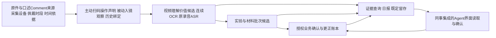

# 实验视觉算法与业务证据链

VisionCortex 将视频处理、FieldRecognition 读数和实验业务逻辑放在同一个工程中。实验模块位于 `src/visioncortex/lab`，原读数组件位于 `src/field_recognition`；两者不是各自部署、各自留存的独立项目。入口为 `visioncortex lab` 或 `python -m visioncortex.lab`。现场身份、模型绑定、服务地址和凭据来自仓库外的私有部署配置。

本文说明三个任务族及其共同消费链。代码已实现、模型实际执行和真实业务验收是三个不同层次；接口存在或测试通过不能代替现场质量证明。

## 从采集到查询与留存

采集设备与实验仪器是不同身份。佩戴者也不自动等于正在操作的人。原件跨文件、跨日或换了一路相机，并不自动开始或结束实验。显式实验、样品、仪器和时间绑定负责组织关联；模型窗口只是处理单位。

后台沿既有任务队列领取、执行、检查点、提交、查询和发布。失败、待核验、候选与业务确认分别保存。更正和晚到证据追加版本，不覆盖原观察或假装当时已经知道后来的关系。留存目录及六字段合同见[统一留存](unified-retention.zh-CN.md)，当前门槛见[状态与依赖](lab-vision-status.zh-CN.md)。

## 口述 Comment 与同一物理时间线

实验室规范口述是有业务含义的 Comment：实验员可以口述所用设备、样品、批次、动作、读数和过程说明。它应与扫码设备/面板/材料历史、视觉动作及 OCR 一起组织实验记录，再进入留存和查询，不能只作为无语义附件保存。

每条口述须回指原音、实际转写正文、词/段时间范围、来源与版本，并保留说话人证据。只有整段对齐时就表达整段范围，不制造词级定位。佩戴者不自动等于说话人，也不必然是实际操作者；缺少说话人依据时保留未知。

统一的是同一物理时间线及可追溯关联，不是把时间相近的文字和画面直接拼在一起。原时钟未标定、实验并发、身份缺失或跨换绑时，不能只凭 near-time 断言同一实验。口述声明、观察到的动作与授权业务指令分别表达；口述和视觉冲突时保留各自 provenance、冲突与 unknown，不删掉其中一方或替其纠正事实。

现有 Timeline、语音候选与证据正文导出提供保存和受控消费基础；规范口述到多源实验归属的自动消费仍需显式适配与真实联调。不能声称 ASR 文本已自动正确分配到所有实验。Agent 的复核与交互由同事整合，沿既有授权命令确认或修订。

### 阶段完成、下一步计划与整体完成

“某样品在天平前配制已完成、现在去烘箱”应表达为 `stage_complete` 加 `next_stage_plan`：完成的是当前配制阶段，后半句是下一阶段计划，样品、批次和实验运行继续保留，不是整个实验结束。计划本身不把当前设备切成下一台；到下一设备主动扫码后，再更新当前设备操作上下文。

只有明确声明整体全部完成，才产生 `experiment_complete`，经授权的整体结束操作才进入实验记录归档。阶段完成、下一阶段计划、参数/设置声明均不触发整体归档，也不自行释放整条实验中的设备/样品关系。

[`comment_transition.py`](../../src/visioncortex/lab/comment_transition.py) 已实现薄接口，通过 `timeline-comment-transition` 消费上游已持久化的结构化 `reviewed_note` 解释记录。记录可由获授权的 Agent 服务产出，不增加一道用户手工确认流程。接口固定原 speech 活动正文指纹、原音 evidence/version/范围、源时钟及精确运行/样品/批次/人员/相机 scope；不靠硬编码自由中文短语猜测整体结束。

接口及选定 fixture 专项已验证，自动入口、实际 ASR/NLU 语义解析到接口的消费和实机 NAS 闭环仍未验收。其语义权威来自持久的上游解释记录，不冒称接口自行证明转写或解释正确。实际解释与同事集成的边界见 [Agent 集成](agent-integration.zh-CN.md)。

## 连续屏幕 OCR

### 输入与字段隔离

`TemporalVideo` 从注册的原媒体区间读取连续解码帧，保留原始整数 PTS、精确 `time_base`、媒体偏移与来源版本。标称帧率、重复尾帧和低频最新截图不能替代连续信息。方向变换须显式登记并记录原到工作像素矩阵；不同输入不能沿用另一来源的旋转假设。

状态按设备或未决轨迹、屏幕、字段与轨迹会话隔离。红绿显示、实际值和设定值、多块面板各自维护缓冲，不能把相邻数字拼成一个字段。身份切换、轨迹丢失、配准失败、PTS 缺口或倒序只重置受影响状态。重复帧不增加独立支持票数。

### 配准、融合与完整性

稳定边框和结构特征参与刚性或透视配准，动态数字与二维码区域排除。缺少稳定结构或配准不通过时拒绝融合。缓冲可选择 3、5、8、15、30 帧，支持跨度上限为一秒；掉帧不能用拉长窗口绕过上限。完整、清晰的单帧可走快路径，无须强等最长窗口。

单帧先过局部质量门，再对有依据的同状态区域融合并输出支持图。最佳帧、均值、中值和最大值是可审查对照，不自动成为可信读数。反光、条纹、对比不足和内容变化都须保留拒识依据。质量分是未校准诊断量，不包装成正确概率。

七段路径分别表达 `ON`、`OFF`、`UNKNOWN`。暗像素不能直接证明段为 OFF，必须有明确局部观测机会或可审查的退化依据。不同数字状态和扫描缺段无法区分时保持不确定，不能把跨状态的笔画并集补成另一个数字。小数点、正负号、单位与字段角色单独取证，不由合法字形、配置精度或历史读数补出。通用 LCD 只有文字一致而无完整性依据时，也不能确认。

输出区分 OCR 原文、数值候选和可支持的值，带方法、源帧、支持区间、变换矩阵、选中帧数、未知/冲突/拒识与实际计时。视觉 `confirmed` 仅表示视觉门控通过，仍不等于业务事实、材料消耗或实验结束。

注册字段可显式设置 `layout.numeric_anchor: true`，在同一 `TemporalVideo → TemporalDisplay` 入口改用原帧选取：最多缓存一秒、30 帧，以各数字槽的可见程度选择一张实际源帧，再调用既有 OCR。两种对比度视图都来自这一帧；回执记录选中帧的 PTS 和变换，不能记成触发调用时的另一帧。数字不跨帧拼接，输出始终为待核对候选；该分支默认关闭，需要已登记的数字槽布局，不代表自动面板发现或屏闪质量已验收。

`video_numeric.review_anchors` 对同一短窗口、同一字段的已有识别结果作完整性复核：较短的数字只标为“可能缺位或读数变化”，不会用较长数字替换；裁切、同帧识别冲突和未见小数点时保留未决。计时显示的冒号保持原样，不把 `12:32` 变成数量 `1232`。这些规则不能证明剩余候选正确，也不会创建设备身份、物料用量或库存操作。

难读字体可在同一入口显式注入 `layout.glyph_adapter`。适配器只接收有源帧依据的单字标签，保存每个字的特征和来源，不保存整串预期读数；所有数字槽从同一原帧、同一个小范围平移中识别。相似度、类别差距或原生对比度不足时逐位输出未知，不补历史数字。部署方须审查标注来源、字体适用范围、训练/测试划分与负例；该实验分支默认关闭，模板匹配不能代替独立验收。

少量已知字形不能覆盖所有数字和屏幕字体；未见过的数字仍可能误匹配到已知类别，不能把通过相似度门槛解释成已证明正确或已证明能拒绝所有未知类别。

`strict_decimal_evidence` 要求在数字槽间、靠近基线的位置观察到独立发光点，排除槽内竖笔画和被搜索框截断的片段。同一帧的 OCR 只漏了小数点时，可由这项像素证据形成数值候选；模型报告的点没有像素依据时仍保留未知。`glyph_ocr_reconcile` 可给出同帧 OCR 与字形的复核建议，严格检查源帧、设备/轨迹、屏幕和字段一致，保持未知位、冲突原文和未确认状态。复核建议不会变成数值事实或扣量操作，也不移动模型原本报告的小数点。

### 原模型与软件执行的边界

OCR 回调复用已有本地提供者，保留实际 token、输入图像指纹、响应和执行回执，不制造 logits。只运行像素/段算法时必须标明没有 OCR 调用；外部供给结果不能冒称本地 HTTP 验证。原字段适配同时保留实际值、设定值、程序参数、状态、时钟和通道。指针表另需真实针尖、明确尺度标定与物理身份；刻度文字本身不是指针读数。

照片按采集来源动态接收；没有设备绑定或注册布局时仍执行整图 OCR，保存原文及未绑定候选。绑定决定归属，不是识别开关。`Readings.json` 和 `UnboundReadings.json` 首先展示中文摘要，列出识别原文、候选值、单位、设备归属、规范化依据和待核对原因；原英文结构、来源及模型记录继续保留。

天平固定小数位沿用 FR 的 `vision_display_rules.configured_rules/apply_rule`，通过 OCR 提供者的显式 `display_rules` 配置接入普通字段及自动面板路径。只对已经明确为质量、单位为 g 的字段应用用户确认的显示格式，与相机、二维码和仪器编号无关。完整整数字形可按原 FR 规则规范化，原文字形、原候选和转换依据同时保留；已识别的小数点不移动，精度冲突保留待核对。全图编号、时间或未映射数字不自动变成天平读数。这个显示格式规范化不同于时序像素恢复，也不构成视觉或业务确认。

## 动态二维码、面板和操作上下文

### 主动扫码与被动入镜是两种事件

实验员主动扫码设备，就是声明该时刻在该设备进行实验/操作。有效扫码应立即建立该操作者、设备和事件时间的当前操作上下文，不等待视觉动作再佐证。声明中已有明确实验运行或目标制备批次时一并关联；缺少这些对象时保留空缺，不虚构运行或批次。

后台摄像头被动拍到二维码则仍是 observation，不能替代实验员的主动声明。这类视觉观察先保留原帧码内容与位置；其面板归属还需注册关系、附着码区域、几何及布局版本支持。码无法解出或无法解析到有效身份时保留待核验，不从清单补造对象。

| 事件 | 直接业务含义 | 仍须区分的边界 |
| --- | --- | --- |
| 实验员主动设备扫码 | 立即建立当前设备操作上下文 | 不自动填具体动作、读数或完成状态；不把所有屏幕归属该设备 |
| 后台二维码被动入镜 | 保存码观察及空间候选 | 不是主动操作声明，不自动建立实际操作关系 |
| 实验员主动材料扫码 | 按事件时间解析材料单元/标签、来源批次，关联显式目标或同一精确 scope 的既有目标 | 不是用量确认或库存扣减；没有明确目标上下文时待关联 |

主动扫码适配已沿同一个 Core、PostgreSQL、时间线及 outbox 实现，内部命令为 `timeline-operator-scan`、`timeline-operator-context`。选定 fixture 专项已验证；自动扫码入口、实际双来源现场链和 NAS 发布仍未验收。不新增 Agent 工具协议或界面。

### 空间归属与被动关注候选

当前主操作设备不覆盖其它同时可见面板。全画面只有一个二维码不表示所有屏幕都属于它；位置相近、房间相同或目标列表中存在该对象，都不能替代空间归属。

`dynamic_video.py` 在同一连续解码循环中接收实际工作像素，执行被动二维码观察、静态结构配准和控制区/背景局部变化测量。缺码、遮挡或配准失败保留未决轨迹，不创建假仪器。这条视觉推断支路的局部持续变化只支持关注/交互候选；它与主动扫码已经建立的操作声明分别保存，不给主动声明附加视觉佐证前置条件。

`DynamicContext` 将来源会话、轨迹、仪器、面板和字段分别建模。主动扫码切换当前设备或被动焦点变化都不结束旧实验，也不重置其材料状态。最终读数按完整支持时间区间重新查询身份和实验归属，不能只用最后一帧的最新绑定。

### 历史关系与晚到证据

可复用标签、容器内容、佩戴时段和仪器使用关系按事件发生区间解析。半开有效期跨换绑边界、时钟未知或多个实验无法区分时，归属保持待核验。未知拍摄时间不能借用当前操作者。

晚到观察或关系更正追加不可变修订，分别保留事件时间和知识时间；`known_at` 可重建当时所知。跨日区间会刷新涉及的报告日期，正文重复出现也不会吞掉后来的报告修订。物理读数可以有视觉支持，而实验归属仍为未知。

### 材料批次与数量

材料类别、来源批次 `source_lot`、实物材料单元、容器、可复用标签、目标制备批次 `process_batch` 和实验运行是独立对象。主动设备扫码建立当前操作上下文，主动材料扫码解析来源并关联明确的当前实验/目标制备批次，形成“设备操作上下文 → 实验/目标批次 ← 材料单元/来源批次”的关系。一个目标批次可包含多种材料并经过多台设备，不按每次设备扫码拆成新批次。

材料扫码显式传入的目标优先；没有重复传入时，可继承同一精确 `person_id`/`camera_id` 组合中、事件时间严格早于本次材料扫码的明确运行/目标批次。继承固定当时快照和来源扫码事件引用，不跨 scope 借用，也不靠时间相近猜批次。没有任何明确目标上下文才保存待关联；后来补到的扫码不悄悄重挂已保存材料。材料关联不等于使用事实或用量；被动识别标签、拿起容器、口述数量或看到秤值也不直接写数量账本。

`MaterialTrace` 保存原文、毛重/净重/设定值/累计量等语义、事件时间、历史关系快照、规则版本及证据。显式 occurrence key 合并同一动作的多份证据，不能仅凭数量相同合并两个动作。数值比较采用 Decimal 和明确量纲换算，原字符仍保留。

`MaterialBatch.source_lot()` 只聚合显式属于该来源批次的成员；`process_batch()` 只聚合明确指向该目标批次的业务操作。按基础单位分别列出消耗、混合、分装、转移、退回、损耗和测试流量。`Core.used` 包含混合等操作，不是全局物理消耗量；任意退回也不自动抵扣某次先前消耗。

更正保留旧账和反向条目，当前有效业务行取替代单，防止双计。分装不会被再计为实验消耗。下游混合物没有明确来源成员关系时，保留谱系和未分摊状态，不猜配方比例。未知初始量保持未知余额，已知小计和完整总量分开。只读汇总不发行材料码、不创建实物、不初始化库存。

## 视频价值、内容边界与模型对照

### 业务类别和证据状态

目标业务类别为有价值实验、有价值非实验、无价值非实验；`unknown` 是独立证据状态。实验性质与价值应分别判断，不能把模型从画面推断的“发生操作”自动当实验，也不能把低变化等待排除出实验。实验员主动设备扫码的操作声明是独立业务上下文，不降格为被动视觉推测。缺音频、静态画面、模糊、未知身份或模型空响应不构成无价值证据。语音讨论可能有价值，不能因画面静止丢弃。

粗扫提供时间候选与盲审入口，精读必须回到原媒体证据。粗扫文本不是精读事实，未选中的原始时间不能消失。规划器显式表达源时间覆盖、未分析间隙、时间校准问题与容量拒绝。既有弱类别和旧筛选结果不是真值；开发/保留集按真正上游来源会话和日期隔离，再生成窗口，不能把派生回放日期或相邻重叠片段当独立样本。

### 内容边界和文件长度

内容/事件边界、名义选择区间、上下文 padding、导出容器范围和实际播放长度分别保存。编码首帧偏移或容器尾隙不能靠放宽时长容差掩盖。`retained_frame_map.py` 提供独立版本的离散逐帧映射，保留原片版本、整数 PTS、Fraction 时间与 RGB 对应；帧间或尾部没有映射的部分保持 unknown，不伪造世界时钟。

外部提交的映射只是 supplied。只有本地实际读取、逐帧解码并验证的过程才能取得本地像素核验凭据。旧版本注册不静默升级，新版本也不能仅凭一份自洽 JSON 宣称原片像素一致。

完整既有片段策略下，一个片段对应一个模型上下文，容量失败进入待处理；不能无声缩图、抽帧、缩短或自动重复相同请求。显式研究策略允许的语义抽样须另记输入改变和未观察区间，不冒称完整原像素/全帧消费。

### 当前模型链路边界

软件已有粗细规划、流隔离租约、原帧交付核验、候选修订、完整片段登记及现有 worker/checkpoint/submit 框架。有限真实模型对照已产生可保留的原文候选与结构拒绝，输入/处理器/响应的执行证据可独立记录。权重缺失、输入不可用、结构失败和 unknown 不应被凑成一个完成的模型对比。

新的三业务类价值候选尚未集成为可验收的默认 worker 消费链。真实模型原文包不能预先等同于数据库提交、日报归属或正式留存完成；旧现场专用研究脚本也不是通用运行入口。组合模型质量、内容边界质量、全天覆盖和夜间成本仍需实际验证。

## 证据正文、查询与同事集成

多源链必须交付正文及其依据，不能只传一个外部证据 ID。ASR/OCR 原文、模型版本、原媒体版本、精确偏移和绑定快照共同限定一条候选。`TimelineEvidenceBundles` 在只读一致快照内导出被显式固定的正文与历史关系；缺失、冲突或时钟不足的项目进入待核验。自带哈希不能证明源字节已回读，也不能证明下游模型实际消费了正文。

已有鉴权内部接口支持时间线 trace、实验片段索引、读数、日报、任务、证据和原媒体访问，以及来源批次/目标批次只读汇总。写入通过既有 command 入口，继续使用客户范围、幂等键、明确 actor、版本和事务约束。具体路由由 `api.py`、命令白名单由 `timeline_commands.py` 定义；这不是新的公开 tool 协议。

同事负责 Agent 界面、交互和确认流程，复用这些既有内部接口读取证据、提交授权确认或更正。工程不新增一套 Agent 产品、MCP 服务或并行账本。Agent 生成的描述仍须有证据，确认后也不删除原候选及历史修订。

## 代码导航

| 任务 | 通用入口 |
| --- | --- |
| 原件接入与实时帧 | [`ingest.py`](../../src/visioncortex/lab/ingest.py)、[`input_layout.py`](../../src/visioncortex/lab/input_layout.py)、[`live.py`](../../src/visioncortex/lab/live.py) |
| 连续 OCR 与配准 | [`temporal_video.py`](../../src/visioncortex/lab/temporal_video.py)、[`temporal_display.py`](../../src/visioncortex/lab/temporal_display.py)、[`temporal_registration.py`](../../src/visioncortex/lab/temporal_registration.py)、[`ocr_fields.py`](../../src/visioncortex/lab/ocr_fields.py) |
| 面板与指针 | [`panel_vision.py`](../../src/visioncortex/lab/panel_vision.py)、[`automatic_readout.py`](../../src/visioncortex/lab/automatic_readout.py)、[`needle_vision.py`](../../src/visioncortex/lab/needle_vision.py) |
| 主动扫码与动态身份 | [`operator_scan.py`](../../src/visioncortex/lab/operator_scan.py)、[`dynamic_video.py`](../../src/visioncortex/lab/dynamic_video.py)、[`dynamic_vision.py`](../../src/visioncortex/lab/dynamic_vision.py)、[`dynamic_context.py`](../../src/visioncortex/lab/dynamic_context.py) |
| 结构化口述阶段转换 | [`comment_transition.py`](../../src/visioncortex/lab/comment_transition.py) |
| 材料历史与批次 | [`domain.py`](../../src/visioncortex/lab/domain.py)、[`material_trace.py`](../../src/visioncortex/lab/material_trace.py)、[`material_batch.py`](../../src/visioncortex/lab/material_batch.py)、[`context_views.py`](../../src/visioncortex/lab/context_views.py) |
| 粗细规划与原帧交付 | [`coarse_fine_research.py`](../../src/visioncortex/lab/coarse_fine_research.py)、[`coarse_fine_native.py`](../../src/visioncortex/lab/coarse_fine_native.py) |
| 留存片段与离散映射 | [`retained_clips.py`](../../src/visioncortex/lab/retained_clips.py)、[`retained_frame_map.py`](../../src/visioncortex/lab/retained_frame_map.py) |
| 口述正文、任务与消费 | [`speech_candidates.py`](../../src/visioncortex/lab/speech_candidates.py)、[`research_evidence_bundle.py`](../../src/visioncortex/lab/research_evidence_bundle.py)、[`timeline_runner.py`](../../src/visioncortex/lab/timeline_runner.py)、[`timeline_tasks.py`](../../src/visioncortex/lab/timeline_tasks.py) |
| 查询与发布 | [`api.py`](../../src/visioncortex/lab/api.py)、[`timeline_commands.py`](../../src/visioncortex/lab/timeline_commands.py)、[`timeline_views.py`](../../src/visioncortex/lab/timeline_views.py)、[`timeline_report.py`](../../src/visioncortex/lab/timeline_report.py) |

通用规则、冻结兼容组件和数据库迁移分别位于 [`contracts/lab`](../../contracts/lab)、[`components/lab`](../../components/lab)、[`migrations/lab`](../../migrations/lab)。部署资产与实际现场规则不从历史配置自动继承。
